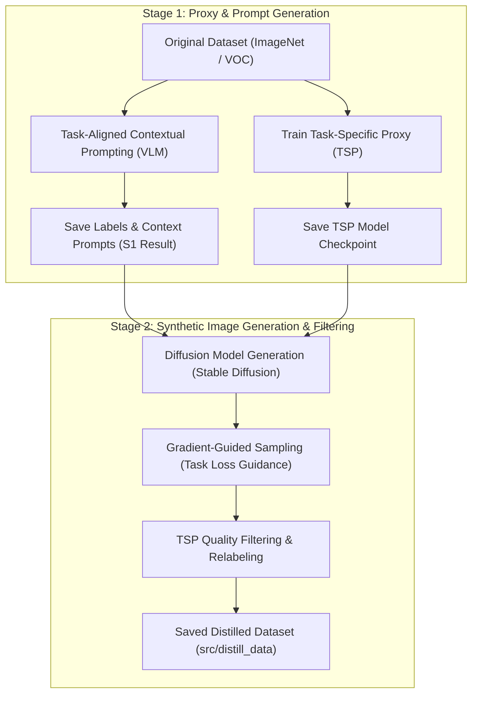

# UniDD: Unified Dataset Distillation Pipeline

[](https://www.python.org/)
[](https://pytorch.org/)
[](https://github.com/huggingface/diffusers)
[](https://github.com/vllm-project/vllm)

**UniDD** is a unified framework for task-aware dataset distillation across vision tasks (Classification, Object Detection, Semantic Segmentation). By leveraging a **Task-Specific Proxy (TSP)** model and a **Vision-Language Model (VLM)**, UniDD generates distilled dataset samples that capture task-aligned contextual knowledge and optimizes image generation via task-guided diffusion models.

---

## 🌟 Key Features

- **Multi-Task Support**: Handles Image Classification (`cls`), Object Detection (`det`), and Semantic Segmentation (`seg`).
- **Stage 1 - Contextual Prompting & Proxy Training**:
  - Trains a lightweight Task-Specific Proxy (TSP) model to capture target domain features.
  - Utilizes a VLM (Qwen2-VL-2B-Instruct) to generate rich task-aligned textual prompts from source images.
- **Stage 2 - Guidance Diffusion & Data Distillation**:
  - Employs Stable Diffusion v1.5 with gradient-guided sampling to generate synthetic samples aligned with task loss.
  - Filters and relabels distilled samples using the trained TSP model to ensure high quality and low noise.

---

## 🏗 Pipeline Architecture



---

## 📁 Repository Structure

```text
UniDD/
├── config.py             # Global, Stage 1, Stage 2 & Test configuration
├── main.py               # Main pipeline execution script
├── stage1.py             # Stage 1 workflow coordinator
├── stage2.py             # Stage 2 workflow coordinator
├── _utils.py             # Helper utilities (Seeding, Indexing, Sampling)
└── src/
    ├── _dataset.py       # Custom Datasets (ImageNet, PascalVOC, DistilledDataset)
    ├── _stage1.py        # TaskSpecificProxy & TaskAlignedContextualPrompt modules
    ├── _stage2.py        # DiffusionModel & Gradient-Guided Sampling module
    ├── org_data/         # Original dataset storage directory
    ├── tsp_model/        # Saved TSP model checkpoints (.pt)
    ├── stage1_result/    # Stage 1 generated metadata (.pt)
    ├── stage2_result/    # Stage 2 distilled dataset metadata (.pt)
    └── distill_data/     # Output directory for distilled synthetic images
```

---

## 🚀 Getting Started

### 1. Prerequisites & Installation

Ensure you have Python 3.8+ and CUDA enabled GPU installed. Install required packages:

```bash
pip install torch torchvision --index-url https://download.pytorch.org/whl/cu118
pip install diffusers transformers vllm pillow numpy
```

### 2. Dataset Preparation

Place original datasets under `src/org_data/`:

- **ImageNet (Classification)**: `src/org_data/ImageNet/imagenette2-160/train/`
- **PascalVOC (Detection / Segmentation)**: `src/org_data/PascalVOC/` (with `Annotations`, `JPEGImages`, `ImageSets`, etc.)

---

## 💡 Usage

### Running the Full Pipeline

Run the entire pipeline (Stage 1 -> Stage 2) using `main.py`:

```bash
python main.py
```

### Running Stage 1 Separately

To train the TSP proxy model and generate VLM prompt contexts:

```python
from stage1 import stage1

# Options: "cls", "det", "seg"
s1_results = stage1(task="cls", train_tsp=True, prompt_context=True)
```

### Running Stage 2 Separately

To synthesize distilled images via Stable Diffusion and filter using TSP:

```python
from stage2 import stage2

s2_results = stage2(task="cls", generate_sample=True, random_sample=True)
```

---

## ⚙️ Configuration Reference

Modify hyperparameters in `config.py`:

```python
class config:
    NAME = "cls"                                    # Task identifier: 'cls', 'det', or 'seg'
    IMAGE_SIZE = {"cls": 256, "det": 512, "seg": 512}
    TASK_THRESHOLD = {"cls": 0.9, "det": 0.85, "seg": 0.75}

class stage1_config(config):
    TRAIN_BATCH_SIZE = 32
    LR = 1e-4
    EPOCHS = 25
    MODEL_NAME = "Qwen/Qwen2-VL-2B-Instruct"       # VLM model name

class stage2_config(config):
    MODEL_NAME = "runwayml/stable-diffusion-v1-5"  # Diffusion model name
    SAMPLE_PER_CLASS = 20                           # Distilled samples generated per class
    SAMPLING_STEPS = 250                            # DDIM diffusion steps
    GUIDANCE_SCALE = 7.5                            # Classifier-free guidance scale
    LAMBDA_S = 100                                  # Task loss gradient guidance weight
```

---

## 📜 License

This project is released under the [MIT License](LICENSE).
